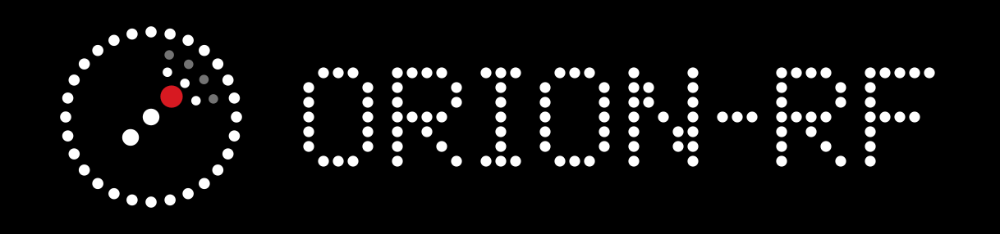

<div align="center">
  
  <p>Portable RF & Wireless <b>Signal-Testing</b> Toolkit for ESP32 — Laboratory Use Only</p>
</div>

## Purpose & Scope

ORION-RF is a **bench/laboratory signal-testing instrument** for ESP32-S3. It is built for
**authorized RF and wireless engineering, education, and security research** in a controlled
environment — characterizing radios, measuring the spectrum, and testing the resilience of
*your own* devices on *your own* bench.

It is **not** a consumer or field device. Every feature is intended to be exercised against
equipment you own or are explicitly authorized to test, inside an RF-controlled space
(e.g. a shielded enclosure / RF test bench), with transmit features kept off the air.

## Intended Use & Responsible Operation

- ✅ **Authorized lab testing only** — on hardware you own or have written permission to test.
- ✅ **Controlled RF environment** — keep transmit/interference features inside a shielded
  enclosure or on a wired/attenuated test link so no third-party or licensed spectrum is affected.
- ✅ **Education & research** — understanding wireless protocols, RF capture/replay, HID, NFC.
- ❌ **Not for use against devices, networks, or people you do not own or are not authorized
  to test**, and not for operation on open/public airwaves.

Operating radio transmitters may be **regulated in your jurisdiction** (e.g. FCC / CE / local
spectrum rules). The operator is solely responsible for lawful, authorized use. This project
is provided for legitimate testing and research under the terms of its [LICENSE](LICENSE); the
authors accept no liability for misuse.

## Features

All features are intended for laboratory signal testing against owned/authorized equipment.

### Wireless
- BLE scanning
- WiFi scanning
- WiFi analyzer (spectrum/channel activity)
- RF capture (WIP)
- RF replay (planned)

### NRF24 — Interference / Robustness Testing
- BLE interference testing
- Bluetooth interference testing
- WiFi interference testing

> These exercise a device-under-test's resilience to RF interference on the 2.4 GHz band and
> are meant for a shielded bench only.

### HID
- BadUSB keyboard emulation (HID input testing)
- BLE mouse emulation

### Utilities
- System information
- Hardware diagnostics
- Device restart

## Hardware
- ESP32-S3 N16R8
- 2x NRF24L01 Module
- 2x CC1101 Module
- PN532 NFC Module
- MicroSD card Module
- TP4056 Charging Module
- OLED display
- Battery-powered portable setup

## Status

> **Note:** the firmware is being rewritten from the Arduino/PlatformIO build to **Rust on
> `std` ESP-IDF**. The table below reflects the feature set (parity target for the rewrite).
> See `CLAUDE.md` for the rewrite architecture and phased plan.

| Feature | Status |
|---|---|
| BLE Scan | Working |
| WiFi Scan | Working |
| WiFi Analyzer | Working |
| BadUSB | Working |
| BLE Mouse | Working |
| BLE Interference Test | Working |
| Bluetooth Interference Test | Working |
| WiFi Interference Test | Working |
| RF Capture | WIP |
| RF Replay | WIP |
| SD Card Support | Planned |
| Emulator | Planned |
| NFC | WIP |


## Installation

### End User Installation

The easiest way to install ORION-RF is through the web installer.

1. Connect your ESP32-S3 to your computer using a USB cable.
2. Open the installer page:
   * https://krolyxon.github.io/orion-rf/
3. Click **Connect** and select your device.
4. Click **Install** and wait for the flashing process to complete.
5. Reboot the device if required.

> Google Chrome, Microsoft Edge, and other Chromium-based browsers are recommended. It may or may not work on Firefox based browsers.

---

### Development Build

#### Clone the Repository

```bash
git clone https://github.com/krolyxon/orion-rf.git
cd orion-rf
```

#### Toolchain Setup

The Rust rewrite targets **`std` ESP-IDF on Xtensa** (`xtensa-esp32s3-espidf`), which needs the
Espressif Rust toolchain (`espup` + the `esp` rustup channel), the ESP-IDF v5.5.3 SDK, and
`espflash`/`ldproxy`.

1. **Prerequisites** — `rustup`, plus the host packages ESP-IDF needs to build. On Arch:
   ```bash
   sudo pacman -S --needed git wget flex bison gperf python \
       cmake ninja ccache dfu-util libusb libffi openssl pkgconf
   ```
   (`pkgconf` + the `systemd` libudev library — part of a base Arch install — are what
   `espflash` links against on Linux.)

2. **Install `espup`** and set up the `esp` toolchain:
   ```bash
   cargo install espup --locked
   espup install
   ```
   This installs the `esp` rustc toolchain into `RUSTUP_HOME` (shared across projects) and writes
   a `~/export-esp.sh`. **You do not need that script for this repo** — `LIBCLANG_PATH` is already
   set in `.cargo/config.toml`, so you can delete it (see Cleaning Up below).

3. **Install the flasher and linker shim:**
   ```bash
   cargo install espflash ldproxy --locked
   ```

4. **Build** from the repo root — the ESP-IDF SDK (~4.4 GB) downloads into `./.embuild/` on the
   first build and is reused afterwards:
   ```bash
   cargo build --release
   ```

This project is configured to stay **self-contained** — the heavy, project-specific pieces live
inside the repo instead of cluttering your home directory:

- **ESP-IDF SDK + its tools (~4.4 GB)** install into `./.embuild/` (not `~/.espressif`), because
  `.cargo/config.toml` sets `ESP_IDF_TOOLS_INSTALL_DIR = "workspace"`. Already gitignored.
- **`LIBCLANG_PATH`** (needed by `bindgen`) is set in `.cargo/config.toml`'s `[env]` block, so you
  do **not** need to `source ~/export-esp.sh` — a plain `cargo build` picks it up. If you ran
  `espup install` and it created `~/export-esp.sh`, you can delete it. The path is version-pinned;
  after an `espup update`, bump the `esp-clang` version segment in `.cargo/config.toml`.
- The **`esp` rustc toolchain (~1.8 GB)** is a normal rustup toolchain and lives in `RUSTUP_HOME`
  (e.g. `~/.local/share/rustup/toolchains/esp`). It is intentionally **shared** across all ESP
  projects — `rust-toolchain.toml` (`channel = "esp"`) selects it automatically.

#### Build & Upload Firmware

```bash
cargo run --release   # builds and flashes + opens the serial monitor
cargo build --release # build only
```

#### Repository Layout & Dual Build

During the rewrite, the Rust and Arduino firmwares live side by side in one repo. The Rust tree
is primary (at the root, where most Rust projects put it); the Arduino tree is kept only as a
1:1 parity reference and is removed once the rewrite is verified on hardware.

```
orion-rf/
├── src/            # Rust firmware (active) — Cargo reads this
├── src-arduino/    # original Arduino firmware (reference only)
├── lib-arduino/    # Arduino libraries (renamed from lib/ to be explicit)
├── Cargo.toml  build.rs  rust-toolchain.toml  sdkconfig.defaults
└── platformio.ini  # points PlatformIO at the -arduino/ trees
```

The two build systems don't collide because each is told where to look:

| Firmware | Command | Reads |
|---|---|---|
| **Rust (active)** | `cargo build` / `cargo run` | `src/`, `Cargo.toml` |
| **Arduino (reference)** | `pio run` / `pio run -t upload` | `src-arduino/`, `lib-arduino/` |

PlatformIO is redirected to the renamed trees via the `[platformio]` section of
`platformio.ini`:

```ini
[platformio]
src_dir = src-arduino
lib_dir = lib-arduino
```

> The Arduino build is retained only for parity reference and will be deleted in a final cleanup
> commit once the Rust firmware is verified on hardware.

#### Troubleshooting

- **`Error: Failed to list cmake-file-api reply directory` / `No such file or directory`** —
  usually a stale ESP-IDF build dir after moving files or switching toolchains. Do a clean
  rebuild:
  ```bash
  rm -rf target .embuild
  cargo build --release
  ```

#### Uninstalling / Cleaning Up

To reclaim space, work from least to most destructive:

```bash
# 1. Project build artifacts (safe; regenerated on next build)
cargo clean                      # removes ./target
rm -rf .embuild                  # removes the project's ESP-IDF SDK + tools (~4.4 GB)
rm -rf .pio .cache               # legacy PlatformIO + clangd caches

# 2. Stray file espup may have dropped in your home dir (not used by this project)
rm -f ~/export-esp.sh
```

Because everything project-specific lives under the repo, deleting the repo directory removes
the SDK and build output with it. The only things left outside are the shared, global installs:

```bash
# 3. Global toolchains — ONLY if you have no other ESP projects
espup uninstall                  # removes the `esp` rustup toolchain (~1.8 GB)
cargo uninstall espflash ldproxy # remove the flasher/linker helpers
```
